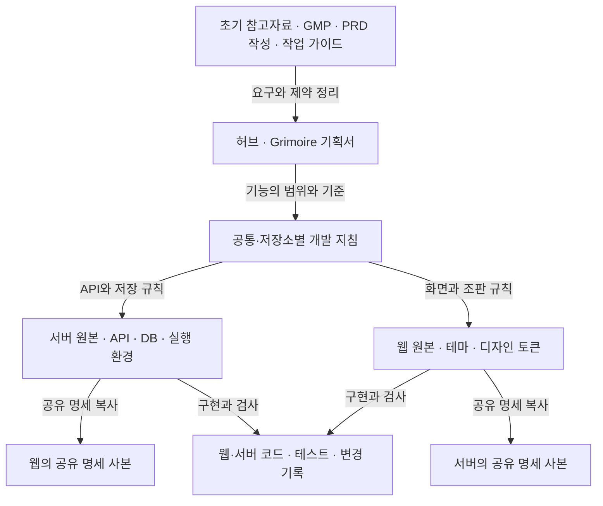

# 하네스, 에이전트, 스킬과 Doc Map

Grimoire의 개발 하네스는 AI가 어떤 문서를 읽고, 어떤 범위를 맡고, 무엇을 실행해 결과를 확인할지 정한 작업 구성이다. 역할별 프롬프트를 만들고, 웹·서버가 따르는 명세를 정하고, 자주 깨진 부분에는 스크립트와 회귀 검사를 붙였다. [하네스 구성과 변경 이력](../research/HARNESS_ENGINEERING.md) · [당시 운영 문서](../AUTOMATION.md)

## Doc Map

GMP는 AI의 초기 참고자료로 넣었다. 기획 대화에서 기능, 제약, 입출력과 검사 기준을 나누고, 역할별 프롬프트가 읽을 파일을 붙였다. [초기 참고자료 활용](../prompt-engineering/README.md) · [기획서](../PLANNING_GRIMOIRE.md)

Doc Map에서는 변경할 문서의 원본을 찾을 수 있다. API·데이터 모델·환경 명세는 서버가, 테마·디자인 토큰은 웹이 관리한다. 원본을 수정한 뒤 상대 저장소의 사본을 갱신한다. 공유 문서 9종을 파일 단위로 비교하는 스크립트가 있다. [Doc Map 원본 HTML](../DOC_MAP.html) · [공유 명세 표](AGENTS.md#1-공유-문서-동기화) · [비교 스크립트](../.claude/scripts/sensor-docs-sync.sh)

## 에이전트 역할과 인계

공개 허브에는 역할 정의 10개가 있다. 기획과 구현, 구현과 검사를 나누고 각 역할에 읽을 문서, 맡을 파일, 인계할 결과를 지정했다.

| 에이전트 | 맡은 일 |
| --- | --- |
| [기획](../.claude/agents/grimoire-planner.md) | 요청을 기능과 작업 범위로 쪼개고, 웹·서버가 지킬 명세와 확인 기준을 넘긴다. |
| [조사](../.claude/agents/grimoire-researcher.md) | 다른 발행 서비스, 모델 가격, RAG 자료를 조사해 기획과 원가 검토에 넘긴다. |
| [원가](../.claude/agents/grimoire-cost-accountant.md) | AI 호출 비용을 기능별로 비교하고 포인트와 원가 기준을 검토한다. |
| [시각 검수](../.claude/agents/grimoire-visual-canon-keeper.md) | 사슴악마의 작가 공간과 목차·뷰어를 기준으로 테마와 새 화면을 검토한다. |
| [웹](../.claude/agents/grimoire-web.md) | Next.js 화면, 테마·회차 뷰어, 요청 중계를 구현하고 웹 명세를 관리한다. |
| [서버](../.claude/agents/grimoire-server.md) | NestJS API와 Prisma, 인증·결제·AI를 구현하고 서버 명세를 관리한다. |
| [QA](../.claude/agents/grimoire-qa.md) | 웹·서버의 타입, 유닛, 빌드, 브라우저 흐름과 화면을 확인한다. |
| [독립 검증](../.claude/agents/grimoire-verifier.md) | 구현을 수정하지 않고 실제 파일·응답·검사 출력을 다시 확인한다. |
| [인프라](../.claude/agents/grimoire-infrastructure.md) | 배포 이미지, 클라우드 설정, 데이터베이스와 주기 작업을 다룬다. |
| [하네스](../.claude/agents/grimoire-harness.md) | 에이전트 정의, 스킬, 훅, 센서와 관련 설정을 다룬다. |

작업 인계에는 대상 파일, 바꿀 내용, 기대하는 동작과 확인 방법을 담았다. 원가가 달라지는 AI 기능이나 사슴악마 기준에 영향이 있는 화면은 그 영역의 검토를 포함했다. `reports/`의 기획·구현·QA 보고서가 다음 역할의 입력이 됐다. [역할과 흐름](../.claude/knowledge/agent-system.md) · [보고서 인계 형식](../.claude/shared-contracts.md)

## 스킬, 훅과 센서

스킬은 작업별로 읽을 파일과 반복할 검사 순서를 적은 `SKILL.md`다. 공개 허브의 `.claude/skills/`에는 작업 계획·디버깅·코드 리뷰, DB 마이그레이션·배포 이미지 확인·롤백, 완료 전 검증·독립 검증 절차가 있다. 과거에 쓰던 일부 절차는 `_archive`에 모았다. 브라우저 화면 확인은 `.agents/skills/engineering-browser`와 `BROWSER_REVIEW.md`에 따로 적었다. [계획 스킬](../.claude/skills/writing-plans/SKILL.md) · [완료 전 검증 스킬](../.claude/skills/verification-before-completion/SKILL.md) · [브라우저 스킬](../.agents/skills/engineering-browser/SKILL.md) · [화면 확인 기록 방법](../BROWSER_REVIEW.md)

| 구성 | 동작 |
| --- | --- |
| Claude 훅 | `.claude/settings.json`에서 세션 시작, 도구 실행 전·후, 작업 종료 등으로 나눈다. 파일 쓰기 전에는 범위를 확인하고, 수정 뒤에는 해당 코드의 타입과 명세를 대조하는 스크립트를 연결했다. |
| 센서 | 공유 명세 일치, 결제 중복 처리, 배포 이후 상태처럼 한 항목을 확인하는 스크립트다. 설정된 훅이나 Eval에서 필요한 센서를 부른다. |
| Git 훅 | 당시 허브는 커밋 시 지침의 변경과 인벤토리를 대조하고, 푸시 시 회귀 검사를 실행하도록 구성했다. 웹·서버는 각각 테스트와 빌드를 검사하는 훅을 보관한다. |
| Eval | 반복해 검사할 문제와 통과 조건을 JSON으로 남겼다. 실행기와 채점기는 실제 코드 상태나 검사 결과를 읽는다. 앱의 유닛 테스트·브라우저 검사와 별도로 작업 결과를 확인하는 항목도 있다. |

예를 들어 같은 결제에 환불 이벤트가 겹치는 문제는 전액·부분 환불 상태를 먼저 확인하고, 잔액이 충분할 때만 조건부로 환수하도록 처리했다. 당시 센서와 Eval은 해당 상태 검사와 조건부 갱신이 소스에 남아 있는지를 확인한다. [결제 구현과 원장](server-architecture.md#포인트-결제와-구독) · [경합 검사 센서](../.claude/scripts/sensor-payment-race-condition.sh) · [해당 Eval](../eval/tasks/regression-66-payment-race-condition.json)

[Claude 훅 설정](../.claude/settings.json) · [Git 훅](../.githooks/AGENTS.md) · [Eval 구성](../eval/README.md) · [하네스 관계도 원본 HTML](../HARNESS_MAP.html)

## 관계도 읽기

`DOC_MAP.html`에는 문서 위계와 공유 명세가, `HARNESS_MAP.html`에는 에이전트·스킬·훅·센서·Eval의 당시 연결이 있다. 두 HTML은 허브를 받은 뒤 로컬 브라우저에서 연다. 관계도에 적힌 인벤토리 수는 작성 시점의 자료다. 역할의 현재 정의는 에이전트 파일, 훅의 등록은 설정 파일에서 확인한다. 정기 자율 실행은 개발 중 비활성화됐다. 공개본은 해당 스크립트와 설계를 보존한다. [문서 관계도](../DOC_MAP.html) · [하네스 관계도](../HARNESS_MAP.html) · [정기 실행 이력](../AUTOMATION.md)

[구현과 수정 기록으로 돌아가기](implementation.md)
