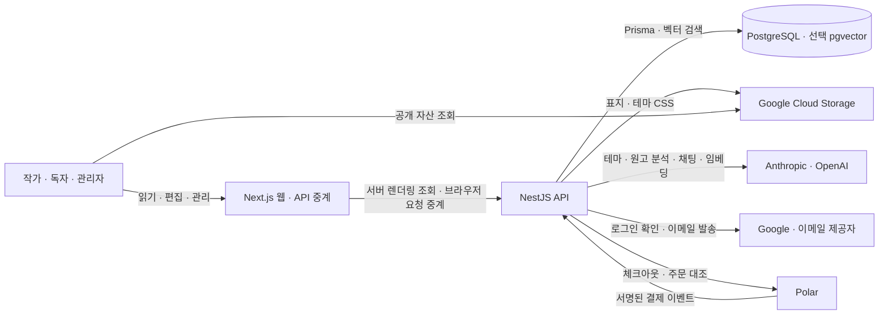

# Grimoire 구현과 수정 기록

Grimoire에서는 작가가 원고를 올려 회차로 발행하고 작가 홈, 회차 목록, 본문의 테마를 고른다. 독자는 탐색 화면에서 작품을 찾아 작가 홈에 들어가고, 회차 하나를 골라 본문을 읽는다. [개발 회고](retrospective.md)

## 전체 구조

Next.js 웹은 화면을 그리고 브라우저의 API 요청을 중계한다. NestJS 서버는 로그인, 원고 처리, 발행 권한, 결제 같은 규칙을 실행한다. PostgreSQL에는 계정, 작품, 원고와 테마, 포인트 원장을 저장한다. 외부 저장소와 결제·AI·인증 제공자는 NestJS에서 연결한다. 웹이 브라우저에 내보낸 테마 CSS와 커버는 설정된 자산 출처에서 읽는다.

허브는 세 저장소의 실행 순서, 기획, 개발 문서를 담는다. 웹과 서버가 각각 독립적으로 빌드되고 배포된다. 결제 재시도와 계정 정리 같은 주기 작업은 NestJS 프로세스 안에서 돈다.

| 문서 | 다루는 내용 |
| --- | --- |
| [웹 아키텍처](web-architecture.md) | App Router, SSR, BFF, 인증 갱신, 테마, 독서 화면, 상태 관리, 글꼴 |
| [서버 아키텍처](server-architecture.md) | 컨트롤러·유스케이스·어댑터, PostgreSQL, 원고·권한, AI, 결제·구독·포인트, 관리자 |
| [인프라와 배포](infrastructure.md) | Azure → GCP, Docker, Cloud Run·Cloud SQL·스토리지, 마이그레이션, 백업, CI, 로컬 검증 |

코드 기준은 공개 웹 [d6c1aee](https://github.com/gelb2/grimoire-web/tree/d6c1aeecc33d1114fe2b4b49ecd87b5f80161684), 공개 서버 [66da852](https://github.com/gelb2/grimoire-server/tree/66da852b3b422737d32d03e474a71907cfa368b4)다.

## 원고와 테마

웹은 Next.js App Router로 탐색, 작가 홈, 작품, 회차 읽기 경로를 제공한다. NestJS 서버는 원고를 받아 문단, 제목, 구분선 등 화면에 그릴 블록으로 파싱한다. 원문, 회차, 테마 설정은 Prisma를 통해 PostgreSQL에 저장한다. 웹은 원고 블록과 테마 설정을 따로 받아 배경, 글자색, 서체, 장식 값을 CSS 변수에 넣는다. 같은 회차를 두고 테마를 바꿀 수 있다. [서버 원고 파서](https://github.com/gelb2/grimoire-server/blob/main/PARSER.md) · [웹 테마 명세](https://github.com/gelb2/grimoire-web/blob/main/docs/theme-spec.md)

작가는 프리셋을 고르거나 원하는 분위기를 문장으로 적어 테마를 만들 수 있다. AI는 작가가 적은 분위기를 색·서체·장식 설정으로 바꾼다. [테마 화면](https://github.com/gelb2/grimoire-web/blob/main/SCREENS.md)

## 원고 파일 업로드

웹의 API 경로는 브라우저 요청을 NestJS 서버에 전달한다. 이 경로에서 DOCX와 이미지가 들어 있는 업로드 본문을 텍스트로 읽으면 바이너리 바이트가 바뀐다. 요청을 `arrayBuffer()`로 읽어 원래 `Content-Type`과 함께 넘기도록 고쳤다. 업로드 검사는 `multipart/form-data` 요청의 본문 바이트가 서버 호출에도 그대로 들어가는지 비교한다. [중계 코드](https://github.com/gelb2/grimoire-web/blob/main/src/app/api/%5B...path%5D/route.ts) · [업로드 검사](https://github.com/gelb2/grimoire-web/blob/main/src/app/api/%5B...path%5D/route.test.ts)

## 사슴악마 회차 카드 복원

2026년 5월 19일 백업을 복원하니 사슴악마 작가 홈에서 가로로 나열됐던 회차 카드가 사라져 있었다. `main`과 `develop`의 관련 웹 파일 7개는 같았다. 백업의 테마에는 `layout: series`가 남아 있었다. 현재 렌더러는 `episodeListLayout`을 읽어서 예전 값을 놓쳤다.

새 설정이 있으면 먼저 읽고, 없으면 예전 `layout`에 들어 있는 레이아웃 값을 읽도록 바꿨다. 작가 홈(`/deerdevil`)에는 원래의 가로 카드가 돌아왔다. 개별 작품 페이지(`/deerdevil/deerdevil`)에는 세로 회차 목차가 있다. 복원 데이터로 Safari에서 작가 홈의 카드에서 1화로 들어가고, 2화로 이동한 뒤, 카드 목록으로 돌아오는 흐름을 확인했다. [레이아웃 선택 코드](https://github.com/gelb2/grimoire-web/blob/main/src/features/theme/episode-list-layout.ts)

## 글꼴과 화면 밀림

작가 홈과 본문은 EB Garamond와 Noto Serif KR을 함께 쓴다. Sass의 글꼴 자체 서빙과 대체 글꼴 크기 보정, Candidate의 선택적 사전 로딩을 참고했다. Grimoire에서는 한글에도 적용되던 라틴 대체 글꼴 크기 보정을 제거했다. Noto Serif KR 파일은 앱에서 직접 제공하고 제목과 목차에 필요한 조각을 먼저 받도록 했다. 첫 화면에 필요한 탐색·작가·작품 데이터는 서버에서 전달하고, 타이핑 제목과 원고가 차지할 자리를 먼저 확보했다.

복원 데이터로 Chrome에서 탐색, 작가 홈, 작품, 1화 본문을 폭 375px과 1440px에서 처음 열고 다시 열었다. 변경 전 최대 누적 레이아웃 이동(CLS)은 약 0.38이었고, 변경 후 16조건에서 모두 0이었다. [글꼴과 CLS 계측](https://github.com/gelb2/grimoire-web/blob/main/reports/FONT_CLS_REVIEW_2026-11-14.md)

## 저장소와 로컬 실행

- [허브](../README.md)는 세 저장소를 받는 명령과 로컬 실행 순서를 안내한다.
- [웹](https://github.com/gelb2/grimoire-web)은 작가 홈, 테마 편집, 회차 읽기, 브라우저 요청 중계를 담는다.
- [서버](https://github.com/gelb2/grimoire-server)는 원고 처리, API, 데이터베이스 마이그레이션, 가상 시드를 담는다.
- [기획서](../PLANNING_GRIMOIRE.md), [웹 테마 명세](https://github.com/gelb2/grimoire-web/blob/main/docs/theme-spec.md), [서버 API 명세](https://github.com/gelb2/grimoire-server/blob/main/docs/api-contract.md)에 기획과 구현의 세부 내용이 있다.

## 기획, 명세와 검사

허브의 기획서를 바탕으로 서버가 API·DB 명세의 원본을 관리하고, 웹이 테마·디자인 명세의 원본을 관리한다. 양쪽이 읽는 공유 명세는 두 저장소에 복사한다. 당시 개발 도구에는 사본이 바뀌었는지 바이트 단위로 대조하는 스크립트와, 역할별 작업 뒤 요구사항·검사 결과를 남기는 프롬프트가 있다. 예전에 고친 카드 레이아웃, 결제 이벤트 중복과 같이 다시 깨지기 쉬운 항목은 회귀 검사 대상으로 기록했다. [문서의 원본 위치](AGENTS.md) · [공유 명세 대조 스크립트](../.claude/scripts/sensor-docs-sync.sh) · [에이전트 작업 평가](../eval/README.md) · [개발 체계 관계도](../HARNESS_MAP.html)
