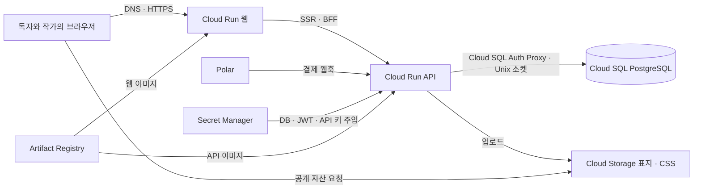

# 인프라와 배포

Grimoire는 과거 Azure에서 웹·API·데이터베이스를 운영했고, 2026년 5월 GCP로 옮겼다. 서비스 운영은 종료했다. 공개 저장소에는 로컬 실행 구성, Docker 이미지 빌드, 당시 배포 스크립트와 운영 기록이 남아 있다. [인프라 원본 기록](https://github.com/gelb2/grimoire-server/blob/main/INFRASTRUCTURE.md) · [배포 절차와 환경 설정](https://github.com/gelb2/grimoire-server/blob/main/docs/DEPLOY.md)

## Azure에서 GCP로

| 역할 | 이전 Azure 구성 | 이후 GCP 구성 |
| --- | --- | --- |
| 웹과 API | Azure Container Apps | Cloud Run에 웹·API를 별도 서비스로 배치. 개발·운영 환경을 나눠 네 서비스로 구성했다. |
| 데이터베이스 | Azure Database for PostgreSQL Flexible Server | 개발·운영별 Cloud SQL for PostgreSQL 16. API는 Cloud SQL Auth Proxy의 Unix 소켓으로 연결했다. |
| 이미지 빌드·저장 | Azure Container Registry | Artifact Registry. Cloud Build 소스 배포용 저장소와 수동 Docker 푸시용 저장소를 구분했다. |
| 공개 자산 | Azure Blob Storage | Google Cloud Storage에 표지와 생성한 테마 CSS를 저장한다. 앱은 `BlobStoragePort`에서 GCS 어댑터를 선택한다. |
| 도메인과 로그 | Container Apps 도메인·인증서, Log Analytics | Cloud Run Domain Mapping과 관리형 인증서, Cloudflare DNS, Cloud Logging. |

2026년 5월 27일에 개발·운영 도메인의 트래픽을 GCP로 전환했다. 당시 운영 기록에는 도메인과 Polar 웹훅 경로가 전환 뒤에도 연결됐다고 남아 있다. 마지막 Azure DB 덤프를 보관하고, 6월 4일에 Azure 리소스를 정리했다. 6월 10일에는 Cloud Run에서 구 Azure 스토리지 환경변수를 제거하고 수동 배포 스크립트를 GCP 방식으로 옮겼다. [이관과 Azure 종료 이력](https://github.com/gelb2/grimoire-server/blob/main/INFRASTRUCTURE.md#12-azure-decommission-이력-2026-06-04-완료) · [배포 변경 이력](https://github.com/gelb2/grimoire-server/blob/main/docs/DEPLOY.md)

## 과거 GCP 실행 구성

위 구성을 개발과 운영에 따로 뒀다. API 주소와 자격증명은 환경별로 주입했다. `API_URL`은 웹 컨테이너가 실행될 때 읽으며, `NEXT_PUBLIC_*`로 전달하는 사이트·로그인·CSP 설정은 웹 빌드에 들어간다. 비밀값은 Secret Manager를 사용했다. GCS는 서버가 설정된 버킷에 업로드하고 웹과 브라우저는 공개 자산 URL을 읽는다. [과거 배포 환경표](https://github.com/gelb2/grimoire-server/blob/main/docs/DEPLOY.md) · [웹 빌드 인자](https://github.com/gelb2/grimoire-web/blob/main/Dockerfile)

당시 Cloud Run 웹·API는 최소 인스턴스 0, 최대 1에 두었다. 요청이 없으면 컨테이너가 내려갈 수 있고, 다음 요청에서 다시 시작한다. NestJS의 DB 대조와 웹훅 재시도는 서버 프로세스가 떠 있을 때 움직인다. `/api/health`는 프로세스의 HTTP 응답을 확인하는 경로다. DB 조회나 결제는 별도 확인 항목이다. [Cloud Run 설정 기록](https://github.com/gelb2/grimoire-server/blob/main/docs/DEPLOY.md) · [Health API](https://github.com/gelb2/grimoire-server/blob/main/src/adapter/inbound/http/controller/health.controller.ts)

## 이미지, 배포와 CI

- **웹 이미지.** Node 22 빌드 단계에서 Next.js standalone을 생성한다. 런타임에는 standalone 서버와 정적 파일, `public`을 복사하고 비루트 계정에서 실행한다. [웹 Dockerfile](https://github.com/gelb2/grimoire-web/blob/main/Dockerfile)
- **서버 이미지.** Node 22 빌드에서 Prisma 스키마를 검사하고 클라이언트와 NestJS 출력을 만든다. 런타임에는 빌드 결과와 운영 의존성·스키마를 넣고 비루트 계정으로 실행한다. 운영 모드의 이미지 시작 스크립트는 `RUN_MIGRATION=true`가 있을 때만 마이그레이션한다. [서버 Dockerfile](https://github.com/gelb2/grimoire-server/blob/main/Dockerfile) · [서버 시작 스크립트](https://github.com/gelb2/grimoire-server/blob/main/docker-entrypoint.sh)
- **배포 경로.** GCP 전환 당시에는 `gcloud run deploy --source`가 Cloud Build를 호출했다. 수동 경로는 로컬에서 이미지를 빌드해 Artifact Registry에 `{환경}-{커밋 SHA}` 태그로 올리고 Cloud Run revision에 그 이미지를 지정한다. 배포 스크립트는 프로젝트·리전·서비스·URL·DB 연결·서비스 계정 등 필요한 값을 사용자가 제공해야 시작한다. [서버 배포 절차](https://github.com/gelb2/grimoire-server/blob/main/docs/DEPLOY.md) · [서버 배포 스크립트](https://github.com/gelb2/grimoire-server/blob/main/scripts/deploy-common.sh)
- **GitHub Actions.** 웹 CI는 타입·린트·유닛·웹 빌드를, 서버 CI는 타입·유닛·빌드·Docker 빌드를 검사한다. 자동 배포 정의는 `.yml.disabled`로 보관했다. 서버의 `db-sync-nightly.yml`은 배포 기능과 별개다. 개발·운영의 Cloud SQL 설정, GitHub Secrets와 `DB_SYNC_ENABLED=true`를 넣은 경우에만 동기화 작업이 실행된다. [웹 CI](https://github.com/gelb2/grimoire-web/blob/main/.github/workflows/ci.yml) · [서버 CI](https://github.com/gelb2/grimoire-server/blob/main/.github/workflows/ci.yml) · [DB 동기화 설정](https://github.com/gelb2/grimoire-server/blob/main/.github/workflows/db-sync-nightly.yml)

## 로컬 실행과 DB 복구

| 방식 | 구조와 설정 |
| --- | --- |
| 직접 실행 | 허브의 `scripts/local-run.mjs`가 개인 설정 파일의 로컬 DB·JWT·가상 시드 값을 읽는다. 기본은 웹 3001, API 3000, 격리한 DB 55432다. 외부 AI·결제·저장소·인증·메일 키와 주기 작업을 비활성화한다. |
| Docker Compose | 웹·서버·PostgreSQL 16을 전용 네트워크와 볼륨에 둔다. 컨테이너끼리는 `server:3000`과 `db:5432`를 사용하고, 호스트 포트는 루프백에만 연다. DB 포트 등은 로컬 설정에서 바꿀 수 있다. |
| 원고 분석까지 실행 | 기본 로컬 구성은 원고·테마·읽기 검사용이다. 벡터 검색에는 PostgreSQL `vector` 확장과 임베딩 설정이, 실제 분석·채팅에는 모델 제공자 설정이 추가로 필요하다. |

Prisma의 `migrate deploy`는 서버 저장소에 있는 마이그레이션 36개를 적용한다. 빈 DB에는 가상 작가·독자·작품을 시드할 수 있다. 기존 DB를 보관할 때는 `pg_dump`로 백업하고 다른 DB에 복원해 확인한다. 5월 19일 백업도 원본 DB와 분리해 복원했고, 예전 테마 데이터로 카드 화면을 다시 확인했다. [환경별 실행과 복구](https://github.com/gelb2/grimoire-server/blob/main/docs/environments.md) · [마이그레이션 기록](https://github.com/gelb2/grimoire-server/blob/main/MIGRATION.md) · [로컬 실행 도구](../scripts/local-run.mjs)

2026년 11월 20일에는 새 로컬 복제본과 별도 가상 DB에서 설치, 마이그레이션, 시드와 웹·서버 빌드를 확인했다. 웹 유닛 289개, 서버 유닛 1,267개, API 요청 33개가 통과했다. Chrome에서는 탐색·작가 홈·회차 본문·로그인 화면을 열었다. 이 검사 대상은 로컬의 공개 준비 코드였다. [웹 검사 전략](https://github.com/gelb2/grimoire-web/blob/main/TESTING.md) · [서버 검사 전략](https://github.com/gelb2/grimoire-server/blob/main/TESTING.md)

[구현과 수정 기록으로 돌아가기](implementation.md)
