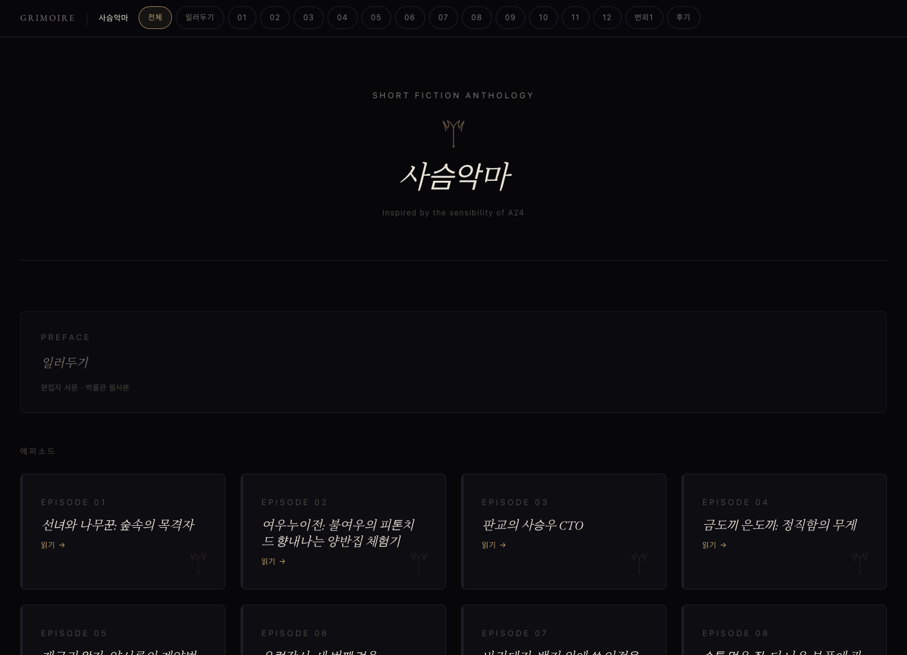
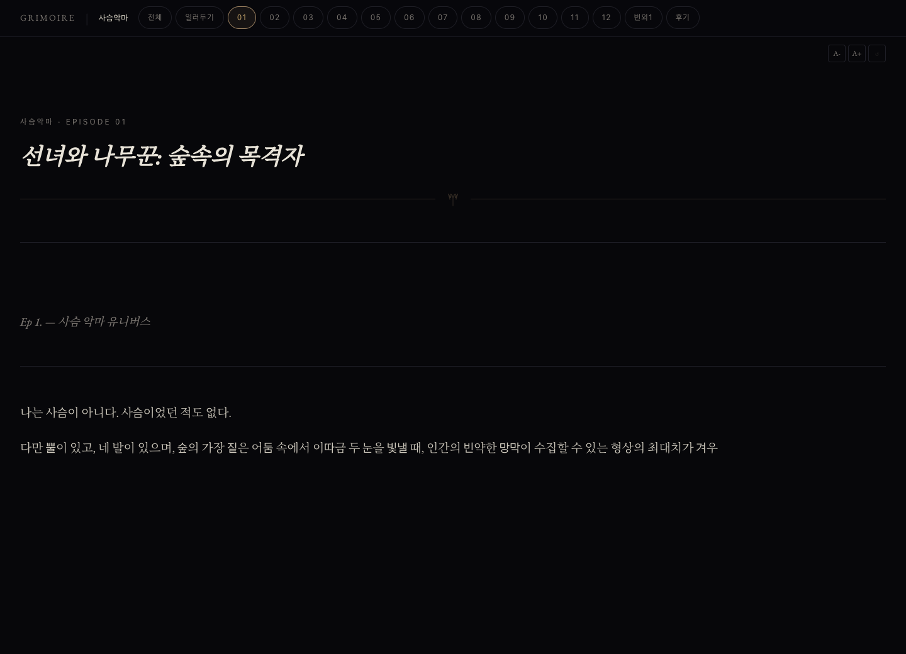

# Grimoire 개발 회고

내 소설을 읽는 뷰어를 만들어 Vercel에 올렸다. 그게 DeerDevil이었다. 이걸 여러 작가가 작품을 올리는 플랫폼으로 키워볼 수 있겠다고 생각했다. 내가 둘러본 소설·웹툰 플랫폼에서는 작가가 자기 작품이 걸리는 공간을 직접 꾸밀 수 있는 곳이 드물었다. 그 공간을 작품에 맞게 꾸밀 수 있도록 Grimoire를 만들기 시작했다.

## 작가가 꾸미는 읽기 화면

DeerDevil에서는 어두운 바탕에 명조체를 쓰고, 제목이 한 글자씩 나오게 했다. 일러두기와 본편을 카드로 나눠 독자가 보고 싶은 회차를 고르게 했다. Grimoire에서도 작가마다 그런 선택을 할 수 있게 하고 싶었다. 작가는 원고를 올려 회차를 발행하고, 자기 홈과 목차, 본문에 쓸 배경색·서체·장식을 고른다. 준비된 테마를 골라도 되고, 원하는 분위기를 문장으로 적어 테마를 만들 수도 있다.

배경색이나 글꼴을 바꿀 때 소설을 다시 올려야 한다면 매번 원고를 손봐야 한다. 그래서 원고와 테마는 따로 저장하기로 했다. DeerDevil에서 쓰던 마크다운 파서와 뷰어를 가져와 여러 작가의 원고를 처리하도록 확장했다. 플랫폼의 탐색 화면은 작품을 찾는 데 쓰고, 작가 홈과 본문에 들어가면 그 작가가 고른 테마를 보여 주도록 화면을 나눴다.

나중에 다시 찾아보니 티스토리 스킨의 홈 구성이나 WordPress.com·Readymag의 글꼴과 색 편집처럼, 코드를 쓰지 않고 페이지를 꾸밀 방법은 이미 있었다. 내가 Grimoire에 넣고 싶었던 건 소설 파일을 올리는 일부터 회차를 관리하고, 목차를 꾸미고, 독자가 읽는 본문을 조판하는 일까지 한곳에서 하는 방식이었다. [시장 재검토](../research/MARKET_REVIEW_2026-11-14.md)

## AI와 개발한 방식

내가 기획과 화면 설계를 맡았다. 어디까지 작가가 편집할 수 있는지, 원고를 어떤 단위로 나눌지, 작품을 읽으러 들어온 독자에게 무엇을 먼저 보여 줄지를 정했다. 초반에는 GMP를 AI의 참고자료로 넣고 기획 대화에서 기능, 제약, 입출력, 검사 기준을 뽑았다. 기획서는 허브에, API와 데이터 명세는 서버에, 테마 명세는 웹에 두었다. 웹과 서버 양쪽에서 쓰는 명세는 사본을 두고 파일이 달라지면 비교할 수 있게 했다. [초기 참고자료 활용](../prompt-engineering/README.md)

공개하기 전에 데이터베이스 백업을 열어 보니 사슴악마의 홈이 기억과 달랐다. 가상 시드로 처음 띄웠을 때는 실제 원고부터 빠져 있었다. 백업을 복원하자 원고는 돌아왔지만, 홈에는 회차 카드 대신 작품 한 건만 나왔다. `main`과 `develop`의 화면 코드를 대조해 보니 관련 파일은 같았다. 예전 테마에는 `layout`이라는 이름으로 레이아웃을 저장했고, 지금 화면은 `episodeListLayout`을 읽었다. Codex가 예전 값도 읽도록 고친 뒤 Safari에서 첫 회차를 열고, 두 번째 회차를 읽고, 카드 목록으로 돌아가는 것까지 확인했다. 원고를 그대로 두고 화면 코드를 고쳤다. [구현과 수정 기록](implementation.md)

## 회사를 관둔 뒤 해 본 일

2025년에 마지막 회사를 관뒀다. 그 뒤 해 본 일을 한 줄로 적으면 이렇다. 한 번도 안 해본 거 해보기, AI가 할 수 없는 것은 무엇인가 파악해보기.

해보고 싶었던 건 바이크로 전국일주 하기, 그림 배우기, 어떤 수단으로든 그림 그려보기, 소설 써보기, 시 써보기였다. 시는 주로 사세구를 쓴다. 인간의 값어치가 기계보다 떨어졌다는 현 시대의 사회인들의 정서를 관통하는 아주 좋은 장르라고 생각한다.

그림을 어떤 수단으로든 그려 본 예는 헤비멕1에 넣은 전투기 도안이다. 검은 동체에 금줄을 넣고 콕핏을 금색으로 바꾸고 싶다고 지시했다. Codex가 내놓은 시안을 보고 게임에 넣을 그림을 골랐다. [도안과 제작 과정](https://github.com/gelb2/HeavyMach/blob/main/docs/public/lux-lunae-intent-20261028.md)

 

## 모두의 창업과 선거 일

Grimoire로 모두의 창업에 지원했고 선정되지 않았다. 그 무렵 제9회 전국동시지방선거 프리랜서 일이 겹쳤다. 선거 기간에 밖에서 직접 파악해야 할 일을 하면서, 빌린 사무실에서는 맥북을 펴고 주소 추출 시스템을 만들었다. 공약 웹페이지를 기획하고 디자인했고, 참고할 사이트와 화면도 직접 찾아봤다. 그때 작업한 정치인은 당선됐다. 나는 그 일이 아주 허접한 방식의 FDE 비슷한 활동이었다고 생각한다. 밖에 나가서 상황을 파악하는 일과 사무실에 돌아와 필요한 도구와 화면을 만드는 일을 같이 했으니까.

선거 일을 우선하면서 Grimoire는 한동안 손을 놓았다. 결국 서비스를 운영하는 계획을 접었다.

## 소스코드 공개

이제 이 프로젝트가 제대로 돌아가느냐, 돈이 되느냐에 관심이 없어서 소스코드를 공개했다. 코드를 그대로 가져다 쇼핑몰을 만들든, 튜토리얼로 쓰든, AI를 이렇게 패서 만들면 안 된다는 반례로 쓰든, 그건 당신 자유다. 여기서 찾을 수 있는 내가 쓴 소설이나 글도 화장실 휴지로 쓰든 인터넷에 돌리든 알아서 해라.
