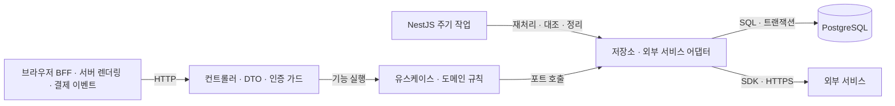

# 서버 아키텍처

NestJS 서버 한 프로세스가 HTTP API와 주기 작업을 실행한다. HTTP 컨트롤러는 요청을 DTO로 받고 인증·권한을 검사한다. 유스케이스는 작품 공개, 테마 활성화, 포인트 차감 같은 규칙을 실행한다. 저장과 외부 호출은 인터페이스로 정의하고, `AppModule`이 Prisma·Anthropic·OpenAI·Google Cloud Storage·Polar·메일 어댑터를 연결한다. [서버 진입점](https://github.com/gelb2/grimoire-server/blob/main/src/main.ts) · [의존성 연결](https://github.com/gelb2/grimoire-server/blob/main/src/app.module.ts)

## 데이터 모델과 발행

| 데이터 | 저장과 조회 |
| --- | --- |
| 계정과 작품 | `Author`가 작가·독자·관리자 계정과 역할을 가진다. 작품은 작가에, 회차는 작품에 속한다. `Theme`에 색·서체·장식 등 테마 설정을 보관한다. |
| 원고 | 회차에 원문과 렌더링용 블록, 회차 종류·순서, 상태를 저장한다. 작품 슬러그는 작가 안에서 유일하고, 회차 슬러그는 작품 안에서 유일하다. |
| 독자 기능 | 북마크, 읽기 진행, 좋아요, 댓글, 구독, 일별 조회수를 저장한다. 탐색과 대시보드가 필요한 집계 데이터를 사용한다. |
| AI와 결제 | 분석 보고서, 채팅 세션과 메시지, 결제·환불·웹훅·포인트 원장을 각각 보관한다. 원고 벡터는 pgvector 테이블에 저장한다. |

원고 파싱과 공개는 별도 요청이다. 업로드 API는 Markdown·TXT·DOCX·HWP·HWPX를 받고, 포맷별 파서가 제목·문단 등 공통 구조로 변환한다. Markdown의 일러두기·후기는 형식에 맞게 따로 처리한다. 작가가 미리보기와 제목을 확인한 뒤 회차를 등록하고 상태를 바꾼다. 미발행(`upload`) 원고는 작성자만 읽는다. 일반 회차 API는 상태와 요청 계정을 확인하고, 공유 URL은 별도의 토큰 조회 경로를 사용한다. [원고 파서](https://github.com/gelb2/grimoire-server/blob/main/src/application/manuscript/parse-manuscript.usecase.ts) · [회차 조회 규칙](https://github.com/gelb2/grimoire-server/blob/main/src/application/content/content.usecase.ts) · [Prisma 스키마](https://github.com/gelb2/grimoire-server/blob/main/prisma/schema.prisma)

## 인증과 관리자 권한

로그인에는 슬러그 또는 이메일과 비밀번호를 쓰며, Google 로그인도 설정할 수 있다. 비밀번호는 bcrypt로 해시한다. 서버는 접근 토큰과 갱신 토큰을 `HttpOnly`, `SameSite=Strict` 쿠키로 보내고 원격 환경에서는 `Secure`를 붙인다. DB에는 갱신 토큰 해시를 저장한다. 갱신 시 이전 토큰을 폐기하고 새 토큰을 발급한다. 이메일 인증과 비밀번호 재설정은 메일 어댑터를 통해 발송한다. 메일 제공자를 설정하지 않은 로컬 환경은 발송하지 않는 어댑터를 쓴다. [인증 컨트롤러](https://github.com/gelb2/grimoire-server/blob/main/src/adapter/inbound/http/controller/auth.controller.ts) · [인증 유스케이스](https://github.com/gelb2/grimoire-server/blob/main/src/application/auth/auth.usecase.ts)

NestJS는 요청 DTO 검증, CORS, Helmet 헤더와 요청 제한을 적용한다. 작가가 수정하는 데이터는 해당 기능에서 소유권을 확인한다. 관리자 API는 관리자 가드를 거쳐 계정·작품·회차·테마, 사용량·포인트·결제, 신고·제재, 공지·추천 작품을 관리한다. 접근과 관리자 변경을 기록하는 테이블도 따로 있다. [관리자 컨트롤러](https://github.com/gelb2/grimoire-server/blob/main/src/adapter/inbound/http/controller/admin.controller.ts) · [API 명세](https://github.com/gelb2/grimoire-server/blob/main/docs/api-contract.md)

## 테마, 객체 저장소, AI

테마는 프리셋과 작가가 고른 값을 바탕으로 해석한다. AI 테마 생성에서는 작가가 적은 설명을 Anthropic에 보내고 결과를 테마 설정으로 저장한다. 별도의 CSS 생성 단계에서 테마를 스타일시트로 만들고, 저장소가 설정돼 있으면 GCS에 올린다. 표지도 GCS 어댑터를 사용한다. GCS를 설정하지 않은 환경은 테마 CSS를 서버 API에서 가져온다. 표지 업로드에는 저장소 설정이 필요하다. [테마 생성](https://github.com/gelb2/grimoire-server/blob/main/src/application/theme/generate-theme.usecase.ts) · [테마 CSS 생성](https://github.com/gelb2/grimoire-server/blob/main/src/application/theme/bake-theme.usecase.ts) · [스토리지 어댑터](https://github.com/gelb2/grimoire-server/blob/main/src/infrastructure/storage/gcs-storage.service.ts)

원고 분석을 위해 회차 텍스트를 조각내고 OpenAI로 임베딩한다. PostgreSQL의 pgvector 어댑터가 1,536차원 벡터와 원고 조각을 저장한다. 분석·채팅은 해당 작품 안에서 원고 조각을 코사인 거리 순으로 조회해 Anthropic 호출에 문맥으로 넘긴다. 분석은 보고서를, 채팅은 세션과 메시지를 남긴다. 분석 API는 연결이 끊길 때 취소 신호를 AI 호출 경로에 전달한다. 시맨틱 캐시 클래스는 준비돼 있으며 분석·채팅의 현재 흐름에는 연결돼 있지 않다. [원고 분석](https://github.com/gelb2/grimoire-server/blob/main/src/application/analysis/novel-analysis.usecase.ts) · [채팅](https://github.com/gelb2/grimoire-server/blob/main/src/application/chat/chat.usecase.ts) · [벡터 저장과 검색](https://github.com/gelb2/grimoire-server/blob/main/src/adapter/outbound/vector/pgvector.adapter.ts)

## 포인트, 결제와 구독

포인트 원장은 무료 적립·구독 월 할당량·응원 선물·유료 충전을 구분한다. 차감 순서는 무료, 구독, 선물, 충전이다. 계정 잔액과 원장 행을 한 트랜잭션에서 쓰고 계정 행 잠금으로 동시에 오는 적립·차감을 직렬화한다. AI 분석과 유료 테마 생성은 호출 전에 차감하고 실패 시 사용한 출처를 기준으로 돌려준다. 채팅은 모델의 입력 토큰 사용량 구간으로 차감액을 계산한다. [포인트 유스케이스](https://github.com/gelb2/grimoire-server/blob/main/src/application/credit/charge-points.usecase.ts) · [원장 저장소](https://github.com/gelb2/grimoire-server/blob/main/src/adapter/outbound/persistence/prisma-credit-ledger.repository.ts)

Polar 체크아웃과 구독 상품은 설정으로 연결한다. 결제 이벤트는 원본 본문의 서명을 검증하고 고유 이벤트 ID를 저장한다. 결제를 `pending`에서 `completed`로 옮기는 조건부 갱신과 포인트 적립을 한 트랜잭션에서 실행한다. 이미 완료된 결제는 같은 상태 전이를 다시 할 수 없어 중복 적립을 막는다. 부분·전액 환불은 결제 금액과 환수할 포인트를 계산하고 상태 및 환불 기록을 남긴다. [결제 유스케이스](https://github.com/gelb2/grimoire-server/blob/main/src/application/payment/payment.usecase.ts) · [결제 트랜잭션](https://github.com/gelb2/grimoire-server/blob/main/src/adapter/outbound/persistence/prisma-payment.repository.ts)

실패한 웹훅 중 재시도할 이벤트는 PostgreSQL 큐 테이블에 둔다. NestJS의 재시도 작업은 처리 시점이 지난 항목을 읽는다. 대조 작업은 Polar 결과와 DB 결제 상태를 비교한다. 이 밖에 만료 결제, 구독 월 할당량, 삭제 계정, 감사기록 정리에 각각 주기 작업이 있다. 서버 CI는 Jest·TypeScript 검사와 빌드, Docker 이미지 빌드를 수행한다. [주기 작업 코드](https://github.com/gelb2/grimoire-server/tree/main/src/application/payment) · [서버 CI](https://github.com/gelb2/grimoire-server/blob/main/.github/workflows/ci.yml)

[구현과 수정 기록으로 돌아가기](implementation.md)
