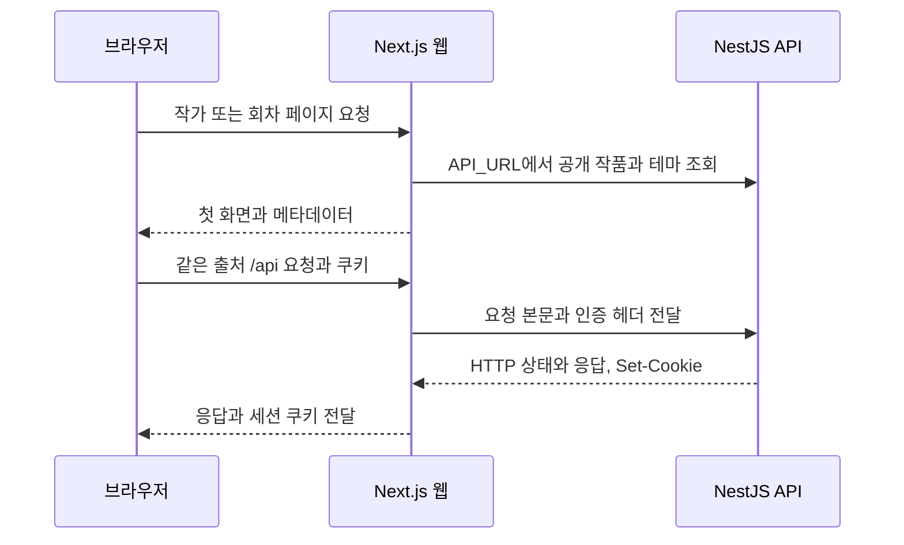

# 웹 아키텍처

웹은 Next.js 16 App Router, React 19, TypeScript로 구성한다. 화면의 경로와 공용 레이아웃은 `src/app`, 독서·테마·인증·계정·크레딧에 필요한 동작은 `src/features`에 있다. Tailwind CSS와 CSS 변수를 사용한다. 탐색 화면은 서비스 공용 색과 조판을 쓰고, 작가 홈과 회차는 작가별 테마를 받는다. [웹 소스](https://github.com/gelb2/grimoire-web/tree/main/src) · [의존성](https://github.com/gelb2/grimoire-web/blob/main/package.json)

## 라우팅과 첫 화면

| 경로 | 역할 |
| --- | --- |
| `/explore` | 인기작·최신작·후원 작가를 처음 그릴 때 API에서 함께 읽는다. 이후 검색과 더 보기는 브라우저에서 처리한다. |
| `/[author]`, `/[author]/[slug]`, `/[author]/[slug]/[episode]` | 작가 홈, 작품 목차, 회차 본문. 작가 레이아웃이 테마와 회차 탐색을 공통으로 맡는다. |
| `/dashboard/*` | 원고 업로드·회차 수정, 테마·프로필, 분석·채팅, 사용량·포인트·멤버십 관리. |
| `/library`, `/shared/[token]`, `/admin` | 독자 보관함, 토큰을 가진 독자에게 보여 주는 공유 회차, 운영자 화면. |

탐색·작가·작품·회차는 요청 시 서버에서 그린다. 서버 컴포넌트는 `API_URL`로 NestJS에 직접 접근한다. 회차 페이지는 본문과 작가·작품을 병렬로 조회하고, 제목과 부제로 페이지 메타데이터를 구성한다. 작가·작품·회차 공용 로더는 `React.cache`로 같은 요청에서 페이지·레이아웃·메타데이터가 같은 데이터를 여러 번 불러오는 일을 줄인다. 회차 API가 404를 돌려주면 없는 페이지를 보여 주고, 네트워크·서버 오류에는 다시 시도할 수 있는 화면을 보여 준다. [라우트 목록과 컴포넌트](https://github.com/gelb2/grimoire-web/blob/main/SCREENS.md) · [서버 렌더링 공용 로더](https://github.com/gelb2/grimoire-web/blob/main/src/lib/public-reader-data.ts)

## 브라우저 요청과 인증 갱신

브라우저는 같은 출처의 `/api/*`를 호출한다. Next.js Route Handler가 쿼리와 요청 헤더, 쿠키, 요청 취소 신호를 넘기고 API의 HTTP 상태, 콘텐츠 타입, `Set-Cookie`를 돌려준다. 업로드는 `arrayBuffer()`로 전달해 multipart 데이터의 바이트와 경계를 보존한다. API 연결 자체가 실패하면 BFF가 502를 반환한다. [BFF Route Handler](https://github.com/gelb2/grimoire-web/blob/main/src/app/api/%5B...path%5D/route.ts)

인증이 필요한 브라우저 요청이 401을 받으면 공용 API 클라이언트가 `/auth/refresh`를 호출한다. 동시에 실패한 요청은 진행 중인 갱신 결과를 함께 기다린다. 갱신에 성공하면 원래 요청을 한 번씩 다시 보낸다. 로그인·가입·Google 인증·갱신 그 자체는 재시도 경로에서 제외한다. 인증 쿠키는 NestJS가 발급하고, `AuthProvider`는 현재 계정과 화면의 로그인 상태를 관리한다. [API 클라이언트](https://github.com/gelb2/grimoire-web/blob/main/src/lib/api/client.ts) · [인증 기능](https://github.com/gelb2/grimoire-web/tree/main/src/features/auth)

## 테마 편집과 독서 화면

작가 레이아웃은 테마 API의 JSON을 받아 `ThemeProvider`에 넘긴다. 배경·글자색·서체·간격·장식을 CSS 변수로 풀고, 서버가 제공한 테마 CSS URL이 있으면 스타일시트도 읽는다. 작가 홈은 테마의 회차 목록 설정에 맞게 카드와 목록을 선택한다. 회차 화면은 서버에서 받은 문단과 제목, 구분선 등의 블록을 읽기 화면에 배치한다. 회차 전환, 글자 크기, 제목 타이핑은 브라우저에서 처리한다. [테마 명세](https://github.com/gelb2/grimoire-web/blob/main/docs/theme-spec.md) · [독서 화면 컴포넌트](https://github.com/gelb2/grimoire-web/tree/main/src/features/reader/ui)

테마 편집 화면은 프리셋 또는 AI 생성 결과를 미리 보여 주고, 편집 중인 값과 저장된 테마를 구분한다. 저장은 테마 업데이트 API로, 공개 화면에 적용하는 동작은 활성화 API로 보낸다. 탐색·내비게이션·테마 편집의 일부 공유 상태에 Zustand 스토어를 두고, 페이지 안에서만 필요한 입력 및 미리보기 값은 React 상태로 관리한다. [테마 편집 화면](https://github.com/gelb2/grimoire-web/blob/main/src/app/dashboard/theme/page.tsx) · [공유 상태](https://github.com/gelb2/grimoire-web/tree/main/src/stores)

## 폰트, 안전한 출처, 빌드

- 작가 공간에 EB Garamond와 Noto Serif KR을 제공한다. Noto Serif KR은 자체 호스팅한 WOFF2 조각에서 화면에 필요한 글자가 있는 조각을 골라 먼저 요청한다. 해시가 붙은 글꼴 파일은 장기 캐시하고, 늦은 글꼴 교체는 `font-display: optional`로 피한다. 읽기 화면의 제목과 본문 자리를 먼저 잡아 글꼴과 데이터 도착 때 화면이 밀리는 일도 줄였다. [계측과 수정 내역](https://github.com/gelb2/grimoire-web/blob/main/reports/FONT_CLS_REVIEW_2026-11-14.md)
- Next.js에서 프레이밍 차단과 CSP를 설정한다. 기본 API는 같은 출처이며, 직접 연결 출처는 `NEXT_PUBLIC_API_ORIGIN`으로 명시한다. `NEXT_PUBLIC_SITE_URL`은 사이트맵의 공개 주소를, `API_URL`은 서버 렌더링과 BFF의 런타임 연결을 정한다. [Next.js 설정](https://github.com/gelb2/grimoire-web/blob/main/next.config.ts) · [CSP 구성](https://github.com/gelb2/grimoire-web/blob/main/src/lib/csp.ts)
- Next.js의 standalone 출력과 정적 파일·공개 자산을 웹 실행 이미지에 담는다. Vitest로 컴포넌트·API 중계·테마를 검사하고, Playwright로 브라우저 흐름을 검사한다. 웹 GitHub Actions CI는 타입·린트·유닛·프로덕션 빌드를 실행한다. 브라우저 E2E는 API와 별도 테스트 데이터를 준비해 실행한다. [웹 Dockerfile](https://github.com/gelb2/grimoire-web/blob/main/Dockerfile) · [웹 검사 전략](https://github.com/gelb2/grimoire-web/blob/main/TESTING.md)

[구현과 수정 기록으로 돌아가기](implementation.md)
