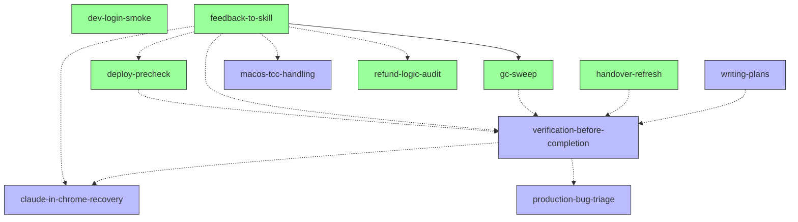

# Skills Dependency Graph (자동 생성)

> **갱신 시점**: 2026-04-26T12:17:03Z
> **생성 스크립트**: `.claude/scripts/generate-skill-graph.sh`
> **raw 데이터**: `.claude/state/skill-graph.json`

## 개요

- Skills 총: **11**
  - 자동 트리거 (UserPromptSubmit 매칭): 5
  - 사용자 명시 호출만 (`disable-model-invocation: true`): 6
  - 트리거 미정의: 0
- 의존 엣지 총: **12** (path 1, mention 11)

## Mermaid 의존 그래프

범례:
- **🟦 파란 노드**: 자동 트리거 (UserPromptSubmit 매칭)
- **🟩 초록 노드**: 사용자 명시 호출만 (`disable-model-invocation`)
- **→ 실선**: 명시적 경로 참조 (`skills/{name}/SKILL.md`)
- **⇢ 점선**: 단순 이름 언급

## Skills 인벤토리

| Skill | 발동 | 트리거 수 | argument-hint | 출력 의존 |
|---|---|---|---|---|
| claude-in-chrome-recovery | 🟦 자동 매칭 | 9 | — | 0 |
| deploy-precheck | 🟩 명시 호출 | 0 | [배포 대상 환경: dev | prod] (기본 dev) | 1 |
| dev-login-smoke | 🟩 명시 호출 | 0 | [선택: 검사할 작가 slug, 기본=deerdevil] | 0 |
| feedback-to-skill | 🟩 명시 호출 | 0 | [필수: feedback 파일명 (예: feedback_polite_ko | 6 |
| gc-sweep | 🟩 명시 호출 | 0 | [선택: dry-run | stage | apply] (기본 dry-ru | 1 |
| handover-refresh | 🟩 명시 호출 | 0 | [선택: dry-run | apply] (기본 dry-run — 결과만  | 1 |
| macos-tcc-handling | 🟦 자동 매칭 | 11 | — | 0 |
| production-bug-triage | 🟦 자동 매칭 | 16 | — | 0 |
| refund-logic-audit | 🟩 명시 호출 | 0 | [선택: 검사할 문구 또는 키워드, 미입력 시 표준 환불 패턴 4종 자동 | 0 |
| verification-before-completion | 🟦 자동 매칭 | 17 | — | 2 |
| writing-plans | 🟦 자동 매칭 | 10 | — | 1 |

## 의존 매트릭스

| FROM \ TO | claude-in-chrome-recovery | deploy-precheck | dev-login-smoke | feedback-to-skill | gc-sweep | handover-refresh | macos-tcc-handling | production-bug-triage | refund-logic-audit | verification-before-completion | writing-plans |
|---|---|---|---|---|---|---|---|---|---|---|---|
| claude-in-chrome-recovery | · |  |  |  |  |  |  |  |  |  |  |
| deploy-precheck |  | · |  |  |  |  |  |  |  | ⇢ |  |
| dev-login-smoke |  |  | · |  |  |  |  |  |  |  |  |
| feedback-to-skill | ⇢ | ⇢ |  | · | → |  | ⇢ |  | ⇢ | ⇢ |  |
| gc-sweep |  |  |  |  | · |  |  |  |  | ⇢ |  |
| handover-refresh |  |  |  |  |  | · |  |  |  | ⇢ |  |
| macos-tcc-handling |  |  |  |  |  |  | · |  |  |  |  |
| production-bug-triage |  |  |  |  |  |  |  | · |  |  |  |
| refund-logic-audit |  |  |  |  |  |  |  |  | · |  |  |
| verification-before-completion | ⇢ |  |  |  |  |  |  | ⇢ |  | · |  |
| writing-plans |  |  |  |  |  |  |  |  |  | ⇢ | · |

## 분석 인사이트

### 강한 의존 (path 참조 ≥2)
- 없음 (현재 모든 skill이 독립적이거나 1:1 참조)

### 트리거 미정의 skill (명시 호출 + 자동 트리거 둘 다 안 됨)
- 없음 (모든 skill 발동 경로 명확)

## 변경 이력

| 일자 | 변경 |
|---|---|
| 2026-04-26 | 초기 생성 (Skills 11 / Edges 12) |

## 관련 정본

- `.claude/scripts/generate-skill-graph.sh` — 본 문서 생성 스크립트
- `.claude/skills/*/SKILL.md` — 각 skill 정본
- `research/HARNESS_ENGINEERING.md` §14.2 — Skills 인벤토리
- `AUTOMATION.md` §1.5 — Skills 매핑
